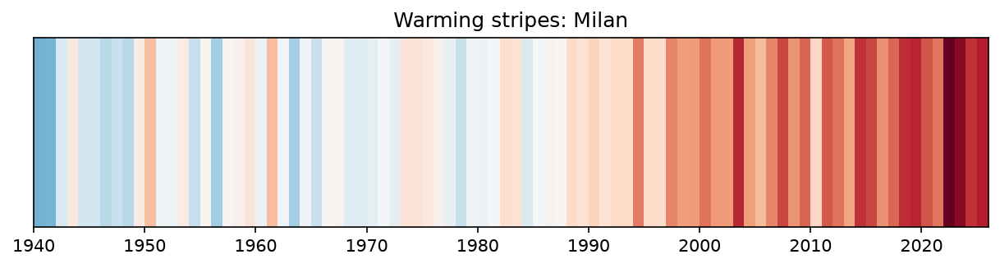

# 🌡️ Weather_report_Panzera
Is the climate really changing? Is the global warming a real thing we should be concerned about? 
This project analyze the weather in 5 cities (Milan, Palermo, Berlin, London, Madrid) trying to find some key elements to
better understand the situation. In the period between 1940 and 2025 I want to highlits temperature trends, anomalies, 
extreme events and comparison between cities to better understand how the climate is changing around us.

Weather Report downloads 86 years of daily weather data for five European cities
and checks, with statistics and charts, whether their climate is really changing.




## What the project does

The project answers one question: **is the climate really changing where we live?**
It looks at Milan, Palermo, Berlin, London and Madrid from 1940 to 2025, five cities
with five different climates.

| Analysis | What it tells |
|----------|---------------|
| **Descriptive statistics** | Mean, standard deviation, minimum and maximum temperature of each city. |
| **Anomalies** | How much warmer or colder each year was compared with the city's 1961-1990 average, with a line chart and the *warming stripes*. |
| **Linear trends** | How fast each city is warming, in °C per decade, with R² and p-value (`scipy.stats.linregress`). The same is done for precipitation. |
| **Period comparison** | The last 30 years (1996-2025) against 1961-1990, with Welch's t-test. |
| **Hot days** | How many days per year reach 30 °C, and how this number changed between the two periods. |
| **Seasonal cycle** | A year × month heatmap of Milan's monthly mean temperature. |

### Main results

| City | Trend (°C per decade) | 1996-2025 vs 1961-1990 | Hot days per year (1961-1990 → 1996-2025) |
|------|-----------------------|------------------------|-------------------------------------------|
| Milan | 0.37 | +1.80 °C | 19.9 → 42.6 |
| Madrid | 0.29 | +1.22 °C | 61.3 → 79.2 |
| Berlin | 0.28 | +1.24 °C | 3.6 → 9.8 |
| Palermo | 0.27 | +1.39 °C | 56.4 → 78.8 |
| London | 0.22 | +1.21 °C | 0.5 → 1.5 |

All five cities are warming, and all the temperature results are statistically
significant (p < 0.001). Milan is warming fastest, and its hot days have more than
doubled. The full discussion, with the limits of the analysis, is in the notebook.

### Precipitation

The same trend analysis was run on the total precipitation of each year:

| City | Trend (mm per decade) | R² | p-value |
|------|-----------------------|----|---------|
| London | +18.4 | 0.20 | < 0.001 |
| Milan | +11.0 | 0.01 | 0.33 |
| Berlin | +3.1 | 0.01 | 0.45 |
| Palermo | +1.9 | 0.00 | 0.76 |
| Madrid | -3.7 | 0.01 | 0.45 |

Unlike temperature, rainfall shows no clear change. Only London has a
significant trend, and even there the straight line explains just 20% of the
year-to-year variation. In the other cities the p-values are far above 0.05:
rainfall changes a lot from one year to the next, and 86 years are not enough
to see a trend in it. The comparison between 1996-2025 and 1961-1990 gives the
same answer. These results should also be read with caution, because ERA5 is
less reliable for precipitation than for temperature.

### How the code works

The data go through the modules of the `weather_report` package, one step each:

```
api.py → storage.py → processing.py → analysis.py → plots.py → notebook
```

1. `api.py` downloads the daily data of one city from Open-Meteo.
2. `storage.py` saves it as a CSV file in `data/raw/`. The next time the file is
   read from disk, so each city is downloaded only once.
3. `processing.py` cleans the data and builds three tables: daily, monthly and yearly.
4. `analysis.py` computes the statistics and `plots.py` draws the charts.
5. The notebook calls these functions and comments the results.

Cities, period, reference period (1961-1990), recent period (1996-2025) and the
hot day threshold (30 °C) all live in one place, [`weather_report/config.py`](weather_report/config.py),
so they are easy to change.

## Data source

- **[Open-Meteo Historical Weather API](https://open-meteo.com/en/docs/historical-weather-api)**:
  free, no API key needed. The project downloads daily maximum, minimum and mean
  temperature and total precipitation.
- **ERA5 reanalysis** (Copernicus Climate Change Service): the only model used, so
  the series has no jumps from one model to another. Each value is the average of a
  cell of about 25 km, not a measurement from a single station.

The downloaded data are **not pushed to GitHub** (see `.gitignore`): they are
downloaded again on the first run.

## Libraries

| Library | Used for |
|---------|----------|
| `requests` | calling the Open-Meteo API |
| `pandas` | cleaning, combining and aggregating the data tables |
| `numpy` | array operations (warming stripes) |
| `scipy` | linear regression and Welch's t-test |
| `matplotlib` | line charts, bar chart and warming stripes |
| `seaborn` | the monthly heatmap |
| `ipykernel` | running the notebook |

Exact versions are listed in [`requirements.txt`](requirements.txt).

## Setup

1. Clone the repository and enter the folder:

   ```bash
   git clone https://github.com/frapanzera-ctrl/Weather_report_Panzera.git
   cd Weather_report_Panzera
   ```

2. Create a virtual environment and install the dependencies (Python 3.11 or newer):

   ```bash
   python -m venv .venv
   source .venv/bin/activate        # on Windows: .venv\Scripts\activate
   pip install -r requirements.txt
   ```

## Run

Open [`notebooks/weather_report.ipynb`](notebooks/weather_report.ipynb) in VS Code,
choose the `.venv` kernel and run all the cells.

On the first run the data of the five cities are downloaded. This takes about
6 minutes, because the code waits 90 seconds between two cities to respect the
API rate limit. After that the data are read from `data/raw/` in a few seconds.

The notebook tells the analysis step by step: loading the data, statistics,
anomalies, trends, period comparison, hot days, seasonal cycle, conclusions and
limits. Every chart is saved in `outputs/figures/` and every result table in
`outputs/tables/`.

The package can also be used without the notebook, from the project folder:

```python
from weather_report import analysis
from weather_report.processing import build_tables

tables = build_tables()
print(analysis.trend_table(tables["annual"]))
```

## Project structure

```
Weather_report_Panzera/
├── weather_report/             # the package: all the code of the project
│   ├── __init__.py
│   ├── models.py               # the City dataclass
│   ├── config.py               # paths, API parameters, periods and cities
│   ├── api.py                  # Open-Meteo API calls and error handling
│   ├── storage.py              # CSV cache, saving tables and figures
│   ├── processing.py           # cleaning, daily/monthly/yearly tables
│   ├── analysis.py             # statistics, trends and t-tests
│   └── plots.py                # charts with matplotlib and seaborn
├── notebooks/
│   └── weather_report.ipynb    # the analysis, step by step
├── data/
│   ├── raw/                    # one CSV per city, downloaded (not on GitHub)
│   └── processed/              # daily, monthly and yearly tables (not on GitHub)
├── outputs/
│   ├── figures/                # the charts as PNG
│   └── tables/                 # the result tables as CSV
├── .gitignore
├── LICENSE
├── requirements.txt
└── README.md
```

Everything in `weather_report/` is plain Python that can be reused in a notebook
or a script, while the notebook only calls these functions and comments the results.

Project for the *Coding for Data Science and Data Management* exam, Università degli Studi di Milano.
